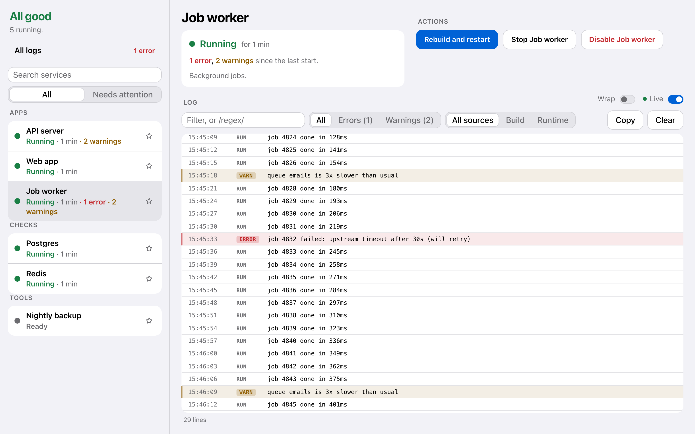
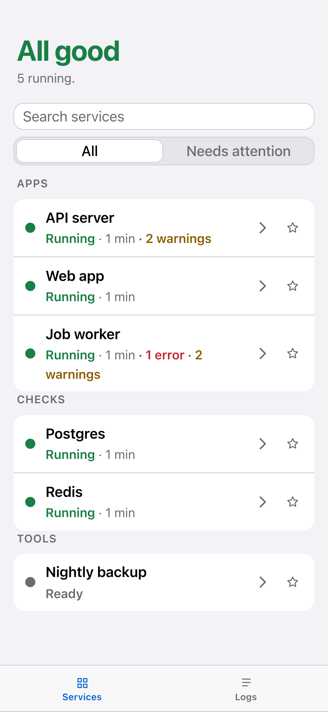
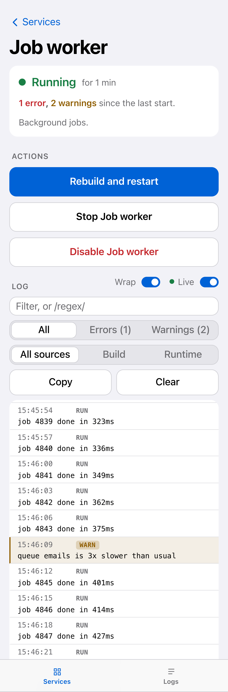

<div align="center">

# Dev Hub

**Run, watch and restart your local services from one page, on your PC or your phone.**

One Go binary · about 17 MB of memory · no Kubernetes, no accounts

[](https://github.com/nineria/devhub/actions/workflows/ci.yml)
[](LICENSE)

<picture>
  <source media="(prefers-color-scheme: dark)" srcset="docs/screenshots/desktop-dark.png">
  
</picture>

<br><br>

<picture>
  <source media="(prefers-color-scheme: dark)" srcset="docs/screenshots/phone-list-dark.png">
  
</picture>
&nbsp;&nbsp;&nbsp;
<picture>
  <source media="(prefers-color-scheme: dark)" srcset="docs/screenshots/phone-detail-dark.png">
  
</picture>

<sub>The same page on a PC and on a phone. These are the demo services in <a href="examples/demo">examples/demo</a>.</sub>

</div>

A small supervisor and dashboard for the services you run on your own machine. It starts your dev servers,
rebuilds them when you save, watches their health, and shows everything in a page you can open from a
second screen or from your phone.

It does what [Tilt](https://tilt.dev) does for local processes, without Kubernetes and without a separate
dashboard to babysit. You describe your services in one JSON file.

## What it does

- **Supervises processes.** Starts each service in its own process group, so stopping it also stops the
  servers a script started. A crash restarts with a growing delay. A service that quits on its own, even
  with exit code 0, counts as a crash.
- **Rebuild on save.** Watches the folders you list, runs your build command, and swaps in the new
  version only if the build succeeds. A failed build keeps the old version running and shows the error.
- **Readiness.** Marks a service as running once its URL answers, and shows "Not responding" when it stops.
- **Health checks.** Runs a command every N seconds and shows whether it passes. Optionally sends a
  heartbeat to another monitor (Gatus, Uptime Kuma, healthchecks.io) when it does.
- **Buttons.** Restart a remote service, turn something on or off, run a script. Anything risky asks first.
- **Logs.** Per-service and combined logs with build and runtime sources, error and warning levels
  (guessed from the text), a text or `/regex/` filter with highlighting, Follow, Clear and Copy.
- **Responsive page.** A sidebar and a large log pane on a PC; a single column with a tab bar on a phone.
  Light and dark follow the system. Star services to pin them.

## Quick start

You need Go 1.22 or newer, Node 20 or newer, and [pnpm](https://pnpm.io).

```bash
git clone https://github.com/nineria/devhub.git && cd devhub
make                                  # builds the page, then the binary
cp devhub.example.json devhub.json    # then edit it for your services
./devhub
```

Open <http://127.0.0.1:8090>.

### Try the demo first

The demo runs three pretend services (an API, a web server and a job worker that logs a warning and an
error) and two checks, with no setup. From the repository root:

```bash
DEVHUB_CONFIG=examples/demo/devhub.json ./devhub
```

## Configuration

`devhub.json` sits next to the binary (or set `DEVHUB_CONFIG`). Commands run through `sh -c`, in `root`
joined with the service's `dir`.

```json
{ "root": "~/code", "services": [ { "id": "api", "name": "API server", "kind": "process", ... } ] }
```

| Field | Kinds | Meaning |
| --- | --- | --- |
| `id` | all | Unique, no spaces. |
| `name`, `desc` | all | Shown in the page. |
| `group` | all | Services with the same group are listed together, in the order groups first appear. |
| `kind` | all | `process` (long running), `check` (repeated command) or `task` (on demand). |
| `dir` | all | Working directory, relative to `root`. |
| `build` | process | Run before `run` and after each change. If it fails, the old version keeps running. |
| `run` | process | The command that runs the service. Keep it in the foreground (`exec` it from a script). |
| `watch` | process | Folders or files, relative to `root`. A change rebuilds and restarts. `node_modules`, `.git`, `dist`, `target`, `.next`, `.run`, `logs`, `data` and `tmp` are skipped. |
| `ready` | process | A URL. The service counts as running once it answers with a status below 400. |
| `check` | check, task | A command. Exit 0 means healthy. For a `task`, the first line of its output is shown. |
| `interval` | check | Seconds between checks. |
| `heartbeat` | check | `{ "url": "...", "method": "POST", "tokenEnv": "NAME" }`. Sent after each passing check. `${NAME}` in the URL is filled from your env files. `tokenEnv` sends that variable as a bearer token. |
| `buttons` | all | `[{ "id", "label", "cmd", "confirm" }]`. A `confirm` text makes the page ask first. |
| `links` | all | `[{ "label", "path" }]`. A path like `:8080` opens that port on the host you opened the hub from. |

See [`devhub.example.json`](devhub.example.json) for a complete example.

### Environment variables

| Variable | Default | Meaning |
| --- | --- | --- |
| `DEVHUB_CONFIG` | `devhub.json` beside the binary | Config file. |
| `DEVHUB_PORT` | `8090` | Port of the page. |
| `DEVHUB_BIND` | `127.0.0.1` | Comma-separated addresses to listen on. |
| `DEVHUB_AUTOSTART` | on | `0` starts the hub without starting the services. |
| `DEVHUB_ENV_FILES` | `~/.config/devhub/env` | Comma-separated files of `KEY=value` lines. They are passed to every command, so tokens stay out of the config. |
| `DEVHUB_PROXIES` | none | `PORT=URL,...` also serves other local pages on the hub's addresses, for example `8082=http://127.0.0.1:8081`. |
| `DEVHUB_UI` | built in | Serve the page from a folder, so you can rebuild it without restarting the hub. |
| `DEVHUB_STATE` | `~/.config/devhub/state.json` | Remembers which services you disabled. |

## Use it from your phone

Listen on your VPN address as well as localhost (Tailscale, NetBird, WireGuard and similar):

```bash
DEVHUB_BIND=127.0.0.1,100.64.0.12 ./devhub
```

Then open `http://100.64.0.12:8090` on a device on the same VPN. If the VPN name resolves to both IPv4 and
IPv6, add the IPv6 address to `DEVHUB_BIND` too.

## Security

**There is no login.** Anyone who can reach the port can restart, stop or disable your services and
run the buttons you configured. So:

- It listens on `127.0.0.1` only unless you say otherwise. Add only addresses you trust, such as a VPN
  interface. Never put it on the open internet.
- Commands come only from `devhub.json`. Nothing in a request can add or change a command.
- Actions need an `X-Devhub: 1` header, which a web page open in your browser cannot send to another
  origin, so a malicious page can't press buttons through your browser.
- There is no TLS. Use a VPN, or put it behind a reverse proxy that adds TLS and a login.

Treat `devhub.json` like a shell script, because it is one.

## Run it at login

On macOS, a launch agent works. Put the binary and config somewhere stable and create
`~/Library/LaunchAgents/dev.devhub.plist`:

```xml
<?xml version="1.0" encoding="UTF-8"?>
<!DOCTYPE plist PUBLIC "-//Apple//DTD PLIST 1.0//EN" "http://www.apple.com/DTDs/PropertyList-1.0.dtd">
<plist version="1.0"><dict>
  <key>Label</key><string>dev.devhub</string>
  <key>ProgramArguments</key><array><string>/path/to/devhub</string></array>
  <key>EnvironmentVariables</key><dict><key>DEVHUB_BIND</key><string>127.0.0.1</string></dict>
  <key>RunAtLoad</key><true/>
  <key>KeepAlive</key><true/>
</dict></plist>
```

Load it with `launchctl load ~/Library/LaunchAgents/dev.devhub.plist`. The hub adds the usual tool folders
(Homebrew, Cargo, Go) to the `PATH` it gives your commands, because launchd starts with a short one.

## How it works

- Each service runs in its own process group; stopping signals the group, then kills it after 8 seconds.
- File watching polls the watched folders every 2 seconds instead of using one file descriptor per file,
  so large `node_modules` trees can't exhaust the limit. Changes are debounced until the files settle.
- Each service keeps its last 2000 log lines in memory. Nothing is written to disk except the list of
  disabled services.
- The page polls `/api/services` every 3 seconds while it is visible, and streams logs with server-sent
  events.

## Development

```bash
make check                           # go vet, go test -race, type check and lint the page
DEVHUB_UI=web/dist ./devhub          # serve the page from disk, then rebuild it with:
cd web && pnpm run build
```

The page is React with Tailwind, TanStack Query and [ui-sdk](https://ui-sdk.dev), built with Vite+.

## What it is not

It has no resource dependencies or start order, no snapshots, no Kubernetes or container support, no
authentication, and no notifications of its own. Use a monitor such as Gatus or Uptime Kuma, fed by the
heartbeat, for alerts.

## License

[MIT](LICENSE)
